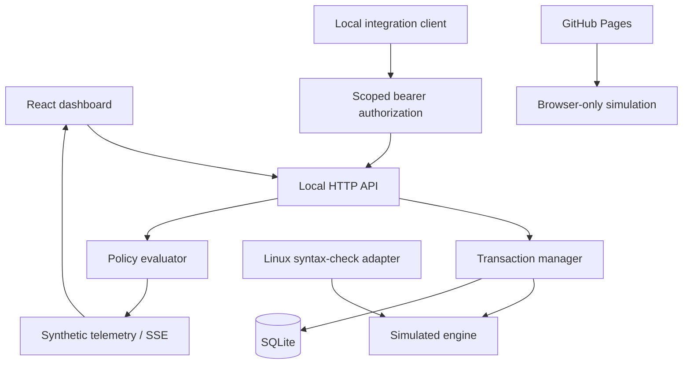

# VeilWall

**Local-first firewall policy management and simulation, built with Go and React.**

   

VeilWall is an open-source development project for designing, testing and managing firewall policies from a single binary. Its signature transaction manager provides a 30-second confirmation window with automatic rollback, while its traffic lab evaluates synthetic IPv4 and IPv6 packets against a staged policy. The same React dashboard runs as a standalone GitHub Pages preview.

> **Integrated beta, not a production firewall.** VeilWall does not capture, transmit, or filter network packets. It does not protect a host. The Linux adapter checks fixed nftables syntax only. Keep the existing system firewall enabled. Do not run this beta as root, grant network-administration capabilities, or expose its local management API to the public internet.

## Features

| Module | Included in this beta |
|---|---|
| Policy editor | Create, edit, delete, import/export JSON, priority, IPv4/IPv6 CIDR validation, disabled/active/shadow modes (simulated) |
| Transactions | Stale revision protection, automatic/manual rollback, confirmation, graceful shutdown, retry on simulated restore failure |
| Persistence | SQLite confirmed policies, audit events and hashed API keys |
| Traffic lab | Synthetic packets, ordered first-match policy evaluation, shadow matches, live synthetic samples and fictional process labels |
| Integration | Local REST API, scoped read/simulate bearer keys, expiration/revocation, SSE dashboard stream, OpenAPI reference |
| Packaging | Embedded React/Tailwind frontend, browser-only Pages preview, setup scripts, Docker/user-systemd templates, CI and Linux prerelease binaries |

## Quick start

Install a supported Go version (minimum 1.23), Node.js 22.12+ or 24+, and Git. Official installers: [Go](https://go.dev/dl/), [Node.js](https://nodejs.org/), [Git](https://git-scm.com/downloads). SQLite is a pure-Go dependency; no separate SQLite server is needed.

Extract the archive into an empty directory. Open the directory containing `go.mod` and `web/package.json`, not an outer folder.

### Windows (PowerShell)

```powershell
go mod tidy
npm.cmd --prefix web install
npm.cmd --prefix web test
npm.cmd --prefix web run build
go vet ./...
go test ./... -v
go run ./cmd/veilwall --demo --db=veilwall.db
```

Open **http://127.0.0.1:8080** (not `localhost`, since Host is checked). Stop with Ctrl+C. If needed, append `--port=8090`. To build a standalone binary after compiling the frontend:

```powershell
New-Item -ItemType Directory -Force bin | Out-Null
$env:CGO_ENABLED = '0'
go build -trimpath -o bin/veilwall.exe ./cmd/veilwall
.\bin\veilwall.exe --demo --db=veilwall.db
```

An equivalent build script is available at `scripts/setup.ps1`. No administrator permissions are needed. Use `npm.cmd --prefix web ci` once `package-lock.json` exists and matches `package.json`.

### Linux / macOS

```bash
bash scripts/setup.sh
./bin/veilwall --demo --db=veilwall.db
```

The `--db` default is `:memory:`. Use a private local directory and one daemon per database; confirmed policies and keys persist only when using a file. Pending changes are never stored, so restarting restores the last confirmed simulated state. Back up the database before upgrades, after stopping the daemon. Never commit a database or token.

## Try it in five steps

1. Open the dashboard and select **Load sample policy** in the empty rules panel.
2. Stage the draft. The server starts a 30-second timer; confirm to persist, or wait for automatic rollback.
3. Open Traffic lab. Samples use documentation-only IP ranges, fictional process labels and synthetic byte counts. The simulator never sends network traffic.
4. Evaluate a synthetic TCP packet from `192.0.2.10` to `198.51.100.1`, port 443. With the sample policy staged or confirmed, expect an accept verdict and a shadow match. Try port 80 to see a simulated denial.
5. Create an API key for `read` or `simulate`, try the matching local integration endpoint, then revoke it. Keys are unavailable in the public browser demo.

## Architecture



The browser preview evaluates packets independently without a server. In the local app the Go evaluator is authoritative. Rules sort by ascending priority, then ID; disabled rules are ignored, shadow matches are recorded until the first terminal active rule, and the default verdict is accept. This is a simplified policy model, not a complete model of Linux netfilter.

## Local API

All requests are loopback-only with an exact Host header. The local dashboard trusts other local processes; the session token is a browser-origin protection, not multi-user login. Integration keys are hashed with SHA-256, use 256-bit random secrets, expire after 30 days, and never grant rule mutation privileges. Only the key creation response returns the raw key. API keys are not accepted for the administrative routes.

| Method | Endpoint | Purpose |
|---|---|---|
| GET | `/api/v1/health` | Version and status |
| GET | `/api/v1/rules` | Rule state and revision |
| GET | `/api/v1/stats` | Rule counts and uptime |
| GET | `/api/v1/audit` | Latest audit events |
| POST | `/api/v1/rules/apply` | Stage validated rule set |
| POST | `/api/v1/transactions/{id}/confirm` | Confirm |
| POST | `/api/v1/transactions/{id}/rollback` | Roll back |
| GET | `/api/v1/telemetry` | Synthetic sample |
| GET | `/api/v1/telemetry/stream` | Bounded SSE stream; reconnects |
| POST | `/api/v1/simulate` | Evaluate synthetic packet |
| GET/POST | `/api/v1/keys` | List/create keys (local token) |
| POST | `/api/v1/keys/{id}/revoke` | Revoke key (local token) |
| GET | `/api/v1/integration/stats` | Bearer scope: read |
| GET | `/api/v1/integration/telemetry` | Bearer scope: read |
| POST | `/api/v1/integration/simulate` | Bearer scope: simulate |

Local POST routes require `X-Veilwall-Token` from `/api/v1/bootstrap` and `Content-Type: application/json`. No public CORS or remote admin access is enabled. Do not include a key in frontend source or GitHub Pages.

Example PowerShell integration (paste a freshly issued read key at the prompt; do not put it in a repository):

```powershell
$key = Read-Host 'Temporary read API key'
Invoke-RestMethod -Uri 'http://127.0.0.1:8080/api/v1/integration/stats' -Headers @{Authorization="Bearer $key"}
Remove-Variable key
```

See [OpenAPI](docs/openapi.yaml), [architecture](docs/architecture.md) and [verification](docs/verification.md).

## Deployment

- **GitHub Pages:** repository Settings → Pages → Source: GitHub Actions; run the Browser demo on GitHub Pages workflow. This serves a simulation only; it cannot run Go, SQLite or nftables. Browser state resets on reload.
- **Linux binaries:** push a `v1.0.0-beta.1` tag after CI passes; release workflow publishes linux/amd64 and linux/arm64 artifacts plus SHA256SUMS as a prerelease.
- **Linux Docker:** `docker compose -f deploy/docker/docker-compose.yml up --build` runs the unprivileged demo. Linux host networking is used only to bind the loopback dashboard; no NET_ADMIN/NET_RAW capabilities are granted. This template is not a Windows Docker Desktop deployment guide.
- **Linux user systemd:** after building, `bash deploy/install.sh` installs the demo as a regular-user service. It does not install or modify host firewall rules.

## Publish your own repository

Create an empty repository named `veilwall`, then run from the project root after tests pass:

```bash
git init
git add .
git status
git commit -m "feat: integrated VeilWall v1 beta"
git branch -M main
git remote add origin https://github.com/YOUR_USERNAME/veilwall.git
git push -u origin main
```

If a repository is already connected, keep its existing `.git` folder and remote, commit the updated source, and use `git push`. Do not force-push. Track `go.sum` and `web/package-lock.json` after generating them; never track node_modules, build outputs, databases, or secrets. See [publishing guide](docs/publish.md) for the release gate.

## Remaining release gates

Stable v1.0 requires native rule compilation and enforcement, an independent crash-safe rollback watchdog, SSH and loopback guardrails, kernel coexistence and recovery tests, real packet/process telemetry, authenticated remote administration, public feed validation, WebSockets and webhooks, plus a security review. This beta uses SSE instead of WebSockets and synthetic traffic rather than kernel measurements. No online threat feed or outbound webhooks are implemented. Do not represent any of these as shipped.

## Contributing

Run `go test ./... -v`, `go vet ./...` and `npm --prefix web test` before opening a PR. See [CONTRIBUTING](CONTRIBUTING.md) and [SECURITY](SECURITY.md). Licensed under [MIT](LICENSE).
