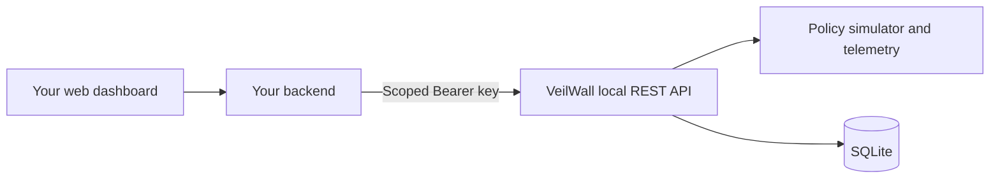
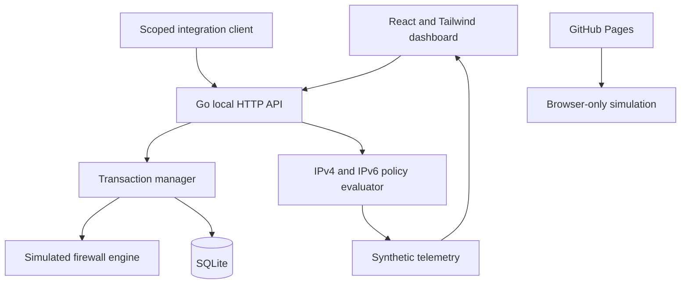

# VeilWall

**Design safer firewall policies. Test changes before trusting them.**

A local-first, open-source firewall policy management and simulation platform built with Go, React, Tailwind CSS and SQLite.

[](https://github.com/TechieEngineer/veilwall/releases) [](LICENSE) 

**[Live browser demo](https://techieengineer.github.io/veilwall/) · [Source code](https://github.com/TechieEngineer/veilwall) · [API reference](docs/openapi.yaml) · [Releases](https://github.com/TechieEngineer/veilwall/releases)**

The live demo is available once GitHub Pages deployment succeeds.

> **Development beta — simulation only.** VeilWall does not currently capture, transmit, or filter real network packets, and cannot protect a machine as a production firewall. The Linux adapter validates fixed nftables syntax only. Keep your existing firewall enabled. No root access or network-administration capabilities are needed for the demo. Do not expose the local management API to the public internet.

## Why I built VeilWall

I wanted to explore how firewall management could be made safer, more accessible and easier to integrate into existing security tools. A small configuration mistake can interrupt legitimate traffic or lock an administrator out of a remote server. Rather than treating firewall rules as a collection of commands, I wanted to build a system where policies could be inspected, tested, changed with a confirmation window and rolled back when something goes wrong.

VeilWall is my attempt to bring these ideas together: a clear dashboard, a modular Go backend, a policy simulator and a simple API for other developers. The long-term goal is to safeguard Linux systems through transparent, recoverable firewall management. This beta is the foundation for that goal, not a replacement for a working firewall.

## What you can do today

| Feature | Current capability |
| --- | --- |
| Policy editor | Create, edit, delete and reorder rules; JSON import/export |
| Transaction manager | Stage changes, confirm within 30 seconds, or roll back automatically/manually |
| Traffic lab | Evaluate fictional IPv4/IPv6 packets against policies without sending network traffic |
| Shadow mode | Record simulated matches without changing the simulated verdict |
| Observability | Synthetic telemetry, fictional process names, SSE dashboard updates |
| Persistence | SQLite confirmed policies, audit records and hashed API keys |
| Integration | Loopback REST endpoints with scoped read/simulate bearer keys |
| Distribution | Embedded React dashboard, GitHub Pages demo, cross-platform demo builds |

## Quick start

### Try it without installing anything

Open the [public browser demo](https://techieengineer.github.io/veilwall/) after deployment. It runs in your browser with fictional data. It does not connect to a server, generate API credentials or modify your firewall. Browser demo state resets on reload.

### Run locally from source

Install a supported [Go](https://go.dev/dl/) release (module minimum 1.23), [Node.js](https://nodejs.org/) 22.12+ or 24+, and [Git](https://git-scm.com/downloads). SQLite is embedded through a pure-Go driver; no separate database server is needed.

**Windows — PowerShell**

```powershell
git clone https://github.com/TechieEngineer/veilwall.git
cd veilwall
go mod tidy
npm.cmd --prefix web install
npm.cmd --prefix web test
npm.cmd --prefix web run build
go vet ./...
go test ./... -v
go run ./cmd/veilwall --demo --db=veilwall.db
```

**Linux / macOS — Bash**

```bash
git clone https://github.com/TechieEngineer/veilwall.git
cd veilwall
bash scripts/setup.sh
./bin/veilwall --demo --db=veilwall.db
```

Open **[http://127.0.0.1:8080](http://127.0.0.1:8080)**. Use the exact printed address rather than `localhost`. If the port is busy, append `--port=8090` and update all API URLs accordingly. Stop with Ctrl+C. Run without administrator privileges. If a command fails, resolve that error before proceeding.

Already cloned the repository? Skip the `git clone` and `cd veilwall` lines; run from the folder containing `go.mod`. Once `web/package-lock.json` exists and matches the package manifest, `npm.cmd --prefix web ci` (or `npm --prefix web ci` on Bash) provides a reproducible install.

### Build a standalone Windows executable

From the project root, after building the frontend:

```powershell
New-Item -ItemType Directory -Force bin | Out-Null
$env:CGO_ENABLED = '0'
go build -trimpath -o bin/veilwall.exe ./cmd/veilwall
.\bin\veilwall.exe --demo --db=veilwall.db
```

The compiled application embeds the dashboard and database migrations. Go and Node.js are not needed to run that binary. Linux prerelease binaries, when successfully built and published, are available from [Releases](https://github.com/TechieEngineer/veilwall/releases) with SHA256 checksums.

The default database is in memory (`:memory:`); the `--db=veilwall.db` option retains confirmed policies, audit records and keys. Keep the file private, use one daemon per database, and stop the daemon before backing it up. Never commit database files or secrets.

## Test the dashboard

1. In the empty Rules panel, select **Load sample policy**.
2. Stage the draft and confirm within 30 seconds. Check that the rules remain.
3. Edit a rule, stage again, and let the timer expire. Verify that the previous rules return and an audit event appears.
4. In **Traffic lab**, evaluate an input TCP packet from `192.0.2.10` to `198.51.100.1` on port `443`. With the sample policy staged or confirmed, expect `accept` and a shadow match. Change the port to `80` to see a simulated `drop`.
5. Export and re-import the policy JSON. Watch the synthetic telemetry update.
6. In the local application, create and revoke a scoped API key. Restart with the same database path and verify persistence of confirmed policies.

All sample addresses are documentation addresses; no packets are sent. The public demo supports simulation but not server-side API keys or SQLite.

## Integrate VeilWall into another application

VeilWall is designed to run independently of your existing application. For this beta, start VeilWall and the integrating backend on the **same machine and in the same network namespace**. The backend reads the integration API and forwards only the necessary non-secret data to its own frontend.



The public GitHub Pages demo is not an API host. This beta deliberately rejects cross-origin requests, non-loopback connections and mismatched Host headers; it also forbids framing the local dashboard. Do not place tokens in React, JavaScript bundles, GitHub Pages or public repositories. A backend running inside Docker generally has a different loopback interface; the simple examples below assume both processes run directly on the same host. Container/remote integrations need a separately designed authentication and networking boundary; do not remove the existing loopback safeguards.

### Step 1 — Check service health

Keep VeilWall running. In a second PowerShell terminal:

```powershell
Invoke-RestMethod 'http://127.0.0.1:8080/api/v1/health'
```

On Bash:

```bash
curl -fsS http://127.0.0.1:8080/api/v1/health
```

Expected fields include `status: healthy`, `version: 1.0.0-beta.1`, `engine: demo` and `enforcement: false` (the engine label may depend on the mode).

### Step 2 — Create a scoped integration key

Open the local dashboard, find **Scoped API keys**, enter a name such as `My dashboard`, select **read** (or both **read** and **simulate** for the optional evaluation example), and generate a key. Copy the secret when it appears; it is returned only once. Keys expire after 30 days and can be revoked from the dashboard.

### Step 3 — Copy-paste the integration commands (PowerShell)

Run these in a second terminal while the local app is running. The key prompt is hidden and compatible with Windows PowerShell 5.1 and PowerShell 7.

```powershell
$secret = Read-Host 'VeilWall API key' -AsSecureString
$key = ([System.Net.NetworkCredential]::new('', $secret)).Password
$headers = @{ Authorization = "Bearer $key" }
$base = 'http://127.0.0.1:8080/api/v1/integration'

# Read status and synthetic telemetry
Invoke-RestMethod -Uri "$base/stats" -Headers $headers
Invoke-RestMethod -Uri "$base/telemetry" -Headers $headers
```

Optional: if you created a key with the `simulate` scope, evaluate a fictional packet:

```powershell
$packet = @{
    direction = 'input'
    protocol = 'tcp'
    source = '192.0.2.10'
    destination = '198.51.100.1'
    port = 443
} | ConvertTo-Json
Invoke-RestMethod -Method Post -Uri "$base/simulate" `
    -Headers $headers -ContentType 'application/json' -Body $packet
```

When finished, clean up the session variables:

```powershell
Remove-Variable secret,key,headers,base -ErrorAction SilentlyContinue
```

### Step 4 — Use the API from Python

For a minimal integration, save the following as `veilwall_client.py` and run `python veilwall_client.py` on the same host while VeilWall is running. Python 3 is the only additional requirement. No pip packages are needed. The key is prompted for rather than written into source code.

```python
import getpass
import json
import urllib.request
import urllib.error

BASE = 'http://127.0.0.1:8080/api/v1/integration'
key = getpass.getpass('VeilWall read API key: ')


def get_veilwall(endpoint):
    if endpoint not in ('stats', 'telemetry'):
        raise ValueError('Unsupported endpoint')
    request = urllib.request.Request(
        f'{BASE}/{endpoint}',
        headers={'Authorization': f'Bearer {key}'},
    )
    with urllib.request.urlopen(request, timeout=5) as response:
        return json.load(response)


try:
    stats = get_veilwall('stats')
    print(json.dumps(stats, indent=2))
except urllib.error.URLError as error:
    print(f'VeilWall unavailable or request rejected: {error}')
```

For a persistent backend integration, load the key from a private environment variable or secret manager instead of prompting. Use `get_veilwall('stats')` in your backend's own authenticated status route. A separate frontend can render the returned rule count, shadow count and engine status without ever receiving the API key. Handle connection failures and label the data as simulated.

### Integration API reference

| Method | Endpoint | Scope | Returns |
| --- | --- | --- | --- |
| GET | `/api/v1/integration/stats` | `read` | Engine, enforcement flag, rule counts and uptime |
| GET | `/api/v1/integration/telemetry` | `read` | A synthetic traffic sample |
| POST | `/api/v1/integration/simulate` | `simulate` | Simulated verdict, matching rule and shadow matches |

Example statistics response (illustrative):

```json
{
  "engine": "demo",
  "enforcement": false,
  "rules": 3,
  "active": 2,
  "shadow": 1,
  "uptime_seconds": 120
}
```

- `401`: missing or malformed bearer credential.
- `403`: invalid, revoked, expired or insufficiently scoped key, or a local access check failed.
- `400`: invalid simulation input.
- `415`: simulation request must use `Content-Type: application/json`.

The integration API cannot mutate policies. The local dashboard has separate administrative routes and a browser-origin protection token; this is not multi-user login. Local processes with port access are trusted. The SSE route `/api/v1/telemetry/stream` is for the local dashboard, not a bearer-authenticated integration stream. See the full [OpenAPI specification](docs/openapi.yaml).

## Architecture



Policies are evaluated in ascending priority, then ID order. Disabled rules are ignored, shadow matches are collected until the first terminal active rule, and the default simulated verdict is accept. This is not a full Linux netfilter model.

## Publishing the GitHub Pages preview

For maintainers: the repository already contains [the Pages workflow](.github/workflows/pages.yml).

1. Open repository **Settings → Pages** and select **GitHub Actions** as the source.
2. Open **Actions → Browser demo on GitHub Pages → Run workflow**, choose `main`, and run it.
3. When both build and deploy jobs pass, open the deployment URL printed by GitHub. For this repository it should be `https://techieengineer.github.io/veilwall/`.
4. On the repository home page, use the **About** settings (gear icon) to set the website URL to the deployed demo and enable the relevant topics.

The workflow builds with `VITE_STATIC_DEMO=true` so the public preview does not depend on the Go backend. GitHub Pages cannot host the executable or its API.

## Deployment and release status

Linux Docker and user-systemd demo templates are included under `deploy/`. They are for unprivileged simulation only. Linux binary releases are generated by the release workflow when a matching version tag is pushed and CI/build succeeds. See [publishing guide](docs/publish.md) and [verification notes](docs/verification.md).

Before publishing updates, run `go vet ./...`, `go test ./... -v`, `npm --prefix web test` and `npm --prefix web run build`. Commit generated `go.sum` and `web/package-lock.json`, not `node_modules`, databases, tokens or executables.

## Roadmap toward stable v1.0

Native nftables rule enforcement, independently recoverable rollback, SSH and loopback safeguards, kernel coexistence tests, real connection/process telemetry, threat feed validation, WebSocket and webhook integrations, secure remote administration and production security review are **not yet implemented**. The current beta uses SSE and synthetic data. Stable release requires these features and independent safety testing.

## Contributing and license

Feedback, bug reports, documentation improvements and reproducible test cases are welcome. See [CONTRIBUTING.md](CONTRIBUTING.md), [SECURITY.md](SECURITY.md), [architecture notes](docs/architecture.md) and the [changelog](CHANGELOG.md).

Released under the [MIT License](LICENSE).
